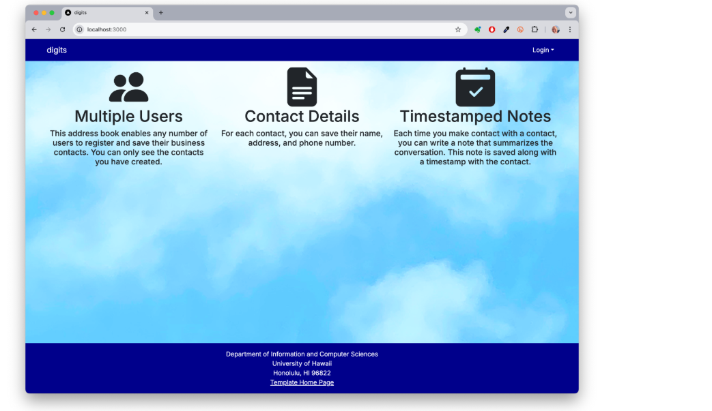
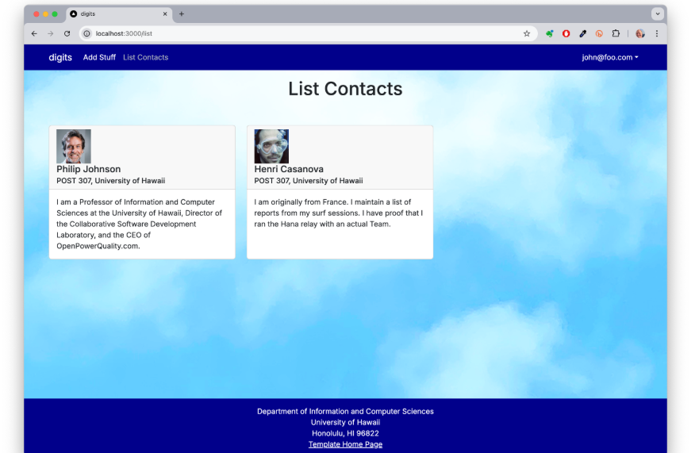
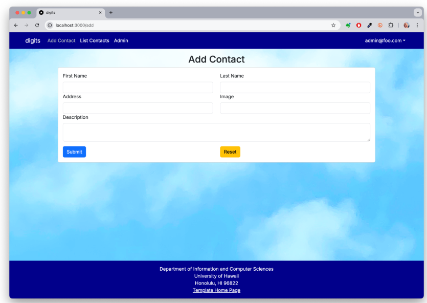
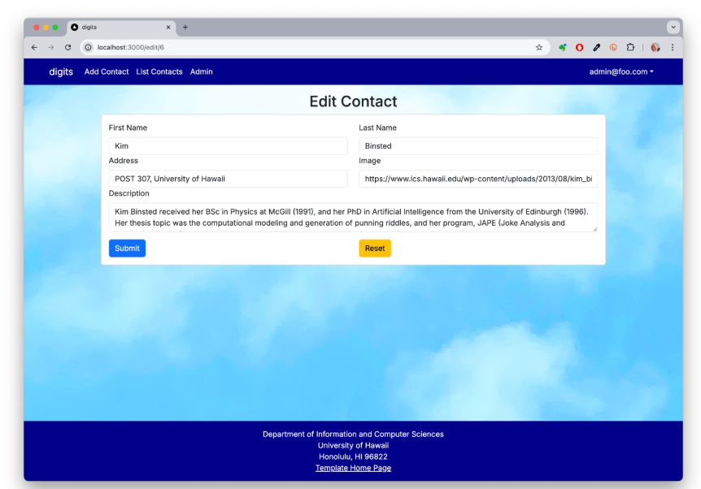
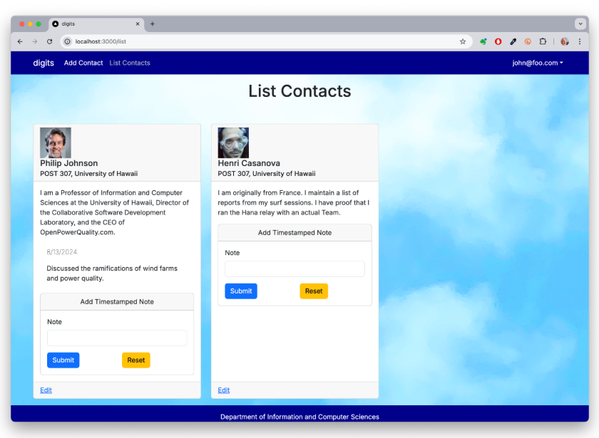
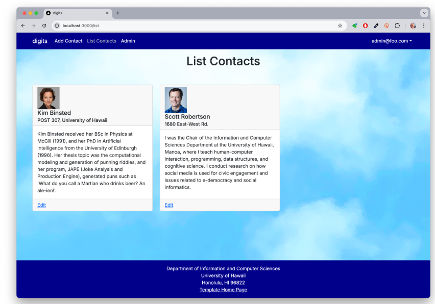

# Digits — Contact Manager

Digits is a Next.js application for managing personal business contacts and recording timestamped notes about conversations. Each user sees their own contacts and notes, while administrators can view the contacts of all users.

## Installation

You need Node.js, npm, and PostgreSQL installed locally. Clone this repository and open its root folder in VS Code or a terminal.

1. Start PostgreSQL and create a database named `digits`:

   ```cmd
   createdb -U postgres digits
   ```

   You can also create the `digits` database through pgAdmin. Skip this command if the database already exists.

2. Install the dependencies:

   ```cmd
   npm install
   ```

3. Copy `.env.example` to `.env` and provide your local PostgreSQL password. Set `AUTH_SECRET` to a strong random value. To generate a secret in a terminal:

   ```cmd
   node -e "console.log(require('crypto').randomBytes(32).toString('base64url'))"
   ```

4. Generate Prisma Client and apply the database migrations:

   ```cmd
   npx prisma generate
   npx prisma migrate dev
   ```

5. Populate the development database with the sample accounts and contacts:

   ```cmd
   npx prisma db seed
   ```

6. Start the application:

   ```cmd
   npm run dev
   ```

7. Open [http://localhost:3000](http://localhost:3000) in your browser.

For the sample seeded database, the development accounts are `john@foo.com` (user) and `admin@foo.com` (admin). Both use the password `changeme`. These accounts are for local practice only.

**Existing databases:** The cleanup migration removes the unused template inventory table and enum. It does not delete Contacts or Notes. Back up your database before running migrations if it contains data you want to retain. Do not reset or drop your database unless you intentionally want to erase its contents.

## Application walkthrough

### Landing page

The home page presents the three core features: support for multiple users, storage of contact details, and timestamped notes. Visitors can use the Login dropdown to sign in or register.

### Sign in and registration

Users can sign in with an existing account or register a new one. Pages that modify contacts require an authenticated session. Users can also change their password using the account menu.

### List Contacts



After signing in, **List Contacts** (`/list`) shows cards with each contact's name, address, photograph, and description. The page only queries contacts belonging to the current user. Each contact card also displays its saved notes, an Add Timestamped Note form, and an Edit link.

### Add Contact



Use **Add Contact** (`/add`) to enter a first name, last name, address, image URL, and description. Submit saves the new contact under the logged-in account. Reset clears entered changes.

### Edit Contact



Select **Edit** from a card to open `/edit/<contact-id>`. The form loads the existing contact information and saves permitted updates. Users may only edit contacts they own.

### Timestamped Notes



Each contact card includes **Add Timestamped Note**. A note is linked to its contact, saved with the current timestamp, and displayed under that contact after submission. The date and text remain available after the page is refreshed.

### Admin page



An administrator can access **Admin** (`/admin`) to see contacts across all accounts, along with their associated notes and owner email. Ordinary users cannot access this page.

## Data model

The PostgreSQL database uses three Prisma models:

- **User:** email, password hash, and role.
- **Contact:** first name, last name, address, image, description, and owner.
- **Note:** note text, linked contact ID, owner, and creation time.

A Contact has many Notes, while every Note references one Contact.

## Verify the project

Run the source checks after installing dependencies:

```cmd
npm run lint
npx tsc --noEmit
```

Check the application by signing in as John, viewing Philip Johnson and Henri Casanova on `/list`, and adding a note to one contact. Sign in as Admin to view all sample contacts on `/admin`.

## GitHub Pages

This `index.md` file is the public project documentation. GitHub Pages serves the documentation and screenshots, not the running Next.js/PostgreSQL application.

After pushing your finalized code to the repository's `main` branch, go to **Settings → Pages → Build and deployment**, choose **Deploy from a branch**, select **main** and **/(root)**, then click **Save**. The site URL will appear in the Pages settings after publishing.
